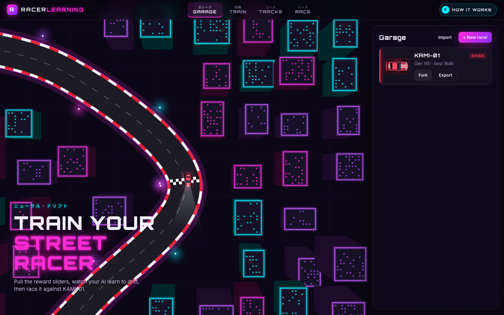
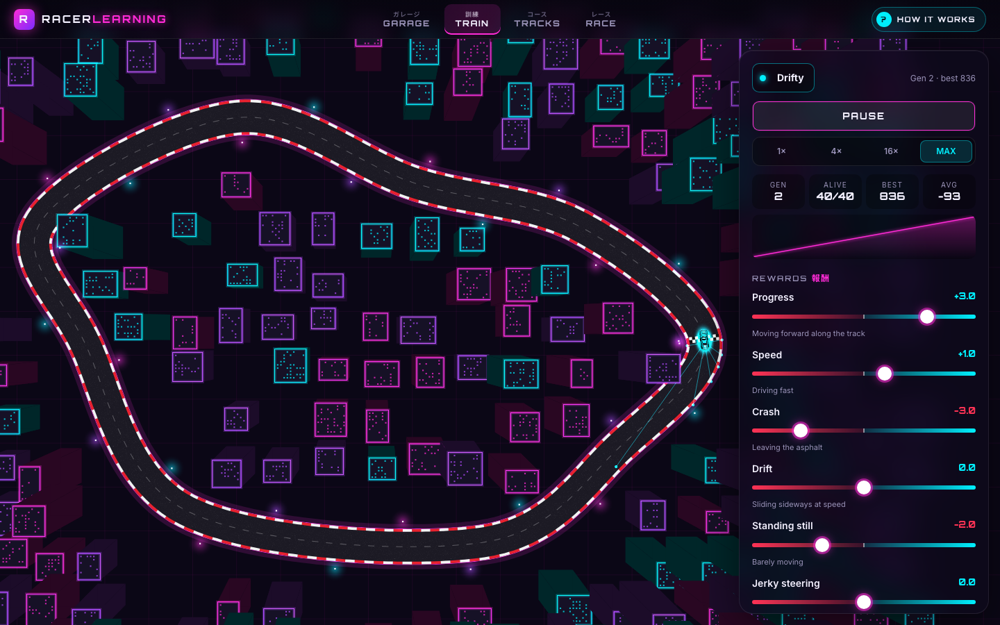
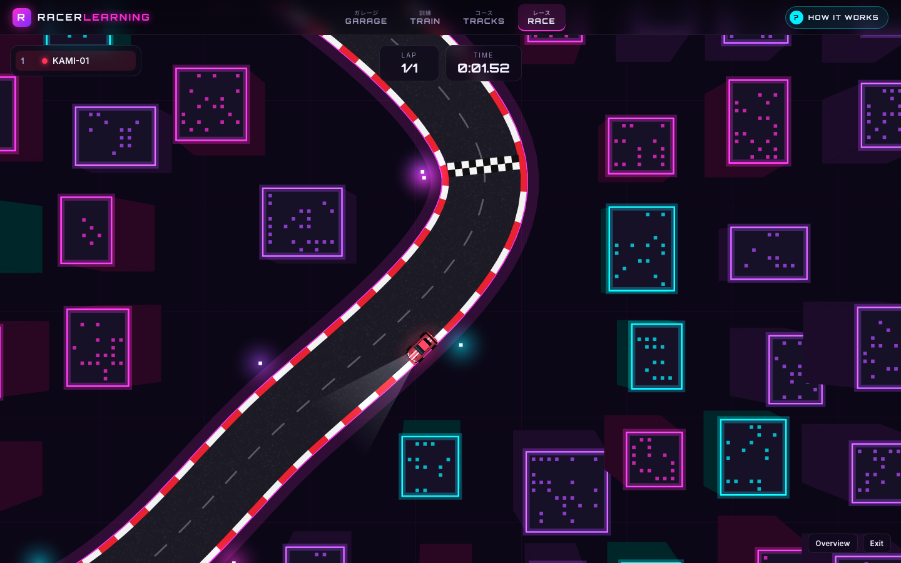
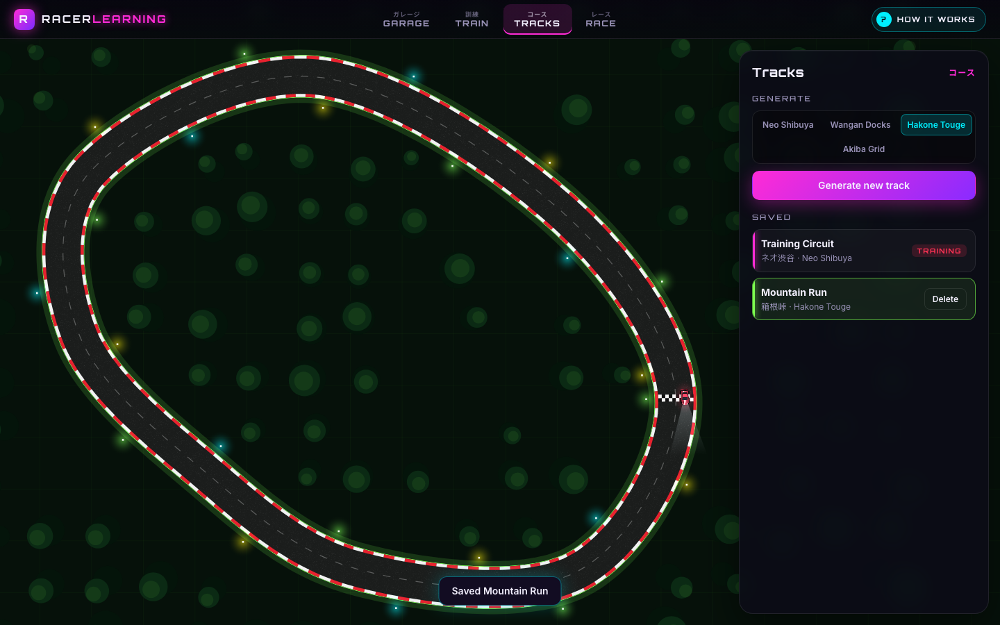
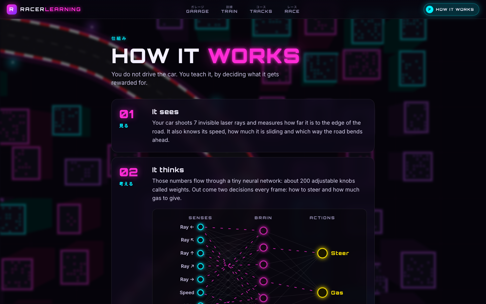
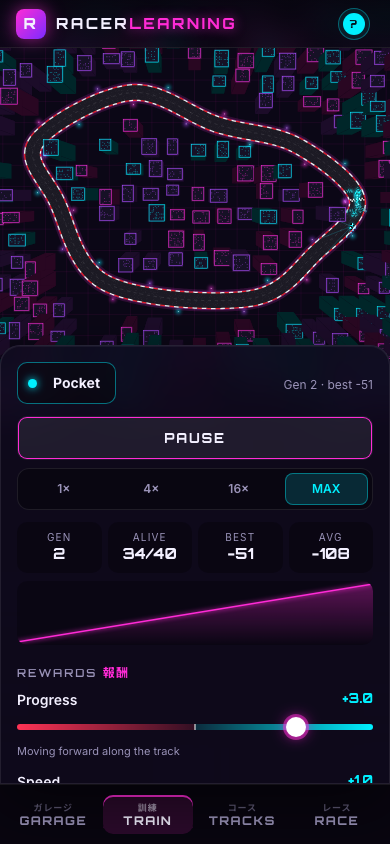
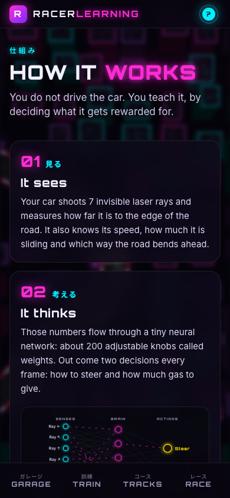

# Racerlearning

**Play: https://zapeman02.github.io/Racerlearning/**

A neon Tokyo street racing game where you never drive. You train an AI racer by tuning what it gets rewarded for, watch it learn through neuroevolution, then race it against the built-in base model **KAMI-01** on generated tracks.



## Background

One evening I wanted to play a game like this: train your own AI racer by tuning what it gets rewarded for, then race it. It didn't exist anywhere except in my head. Thanks to modern AI, combined with what I've learned in my education (OOP, design patterns, testing), I could build it quickly and with quality in a single evening.

## How to play

1. **Garage**: create a racer from scratch or fork KAMI-01.
2. **Train**: drag the reward sliders (progress, speed, crash, drift, standing still, jerky steering) and watch 40 cars evolve. Progress saves automatically.
3. **Tracks**: generate new tracks in four environments and save the ones you like.
4. **Race**: pick a track, up to four racers and a lap count, then go.

| Training | Race |
| --- | --- |
|  |  |
| **Tracks** | **How it works** |
|  |  |

<p>
  
  
</p>

## How it works

Each car sees the road through 7 distance rays plus its speed, slide and the upcoming bend. A tiny neural network (11 → 16 → 2) turns that into steer and throttle. Your sliders define the fitness; each generation the best brains survive and are copied with small mutations. Models and tracks live in your browser (localStorage) and can be exported/imported as JSON.

## Development

```sh
npm install
npm run dev          # local dev server
npm run train-base   # retrain KAMI-01 headless in Node
./check.sh           # typecheck + unit tests + Playwright UI tests (chromium + webkit)
```

Built with TypeScript, Canvas 2D and Vite. No game engine or ML library.
